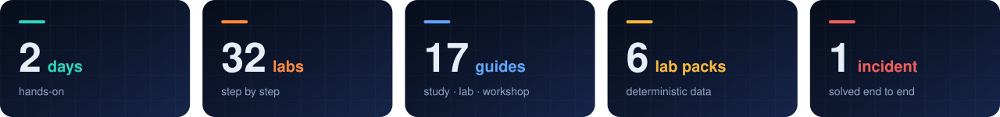
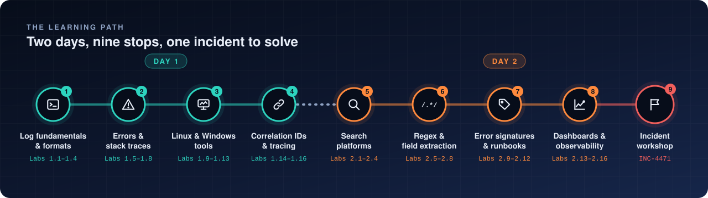
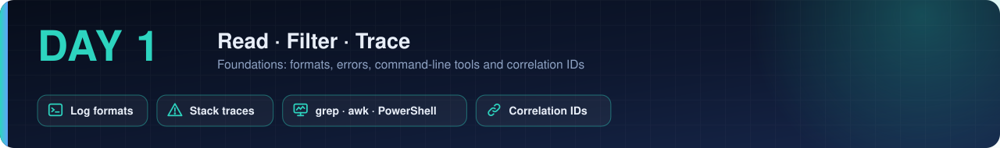
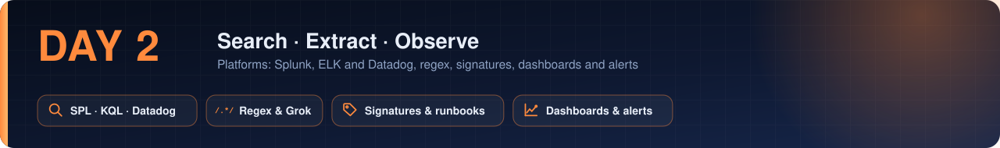
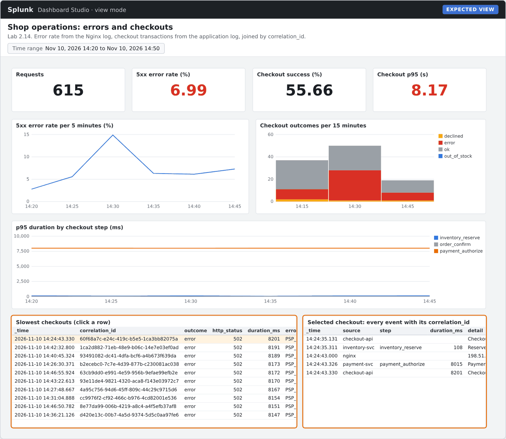
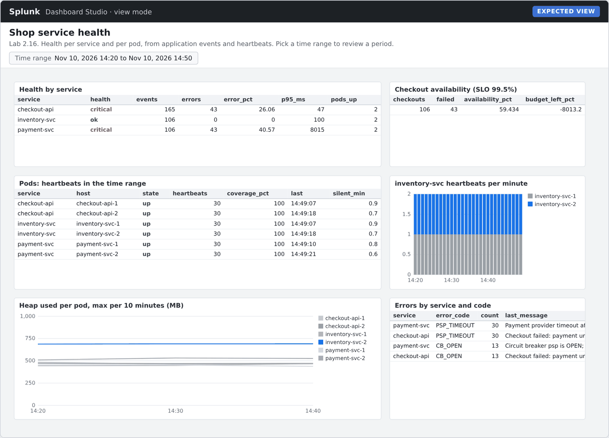
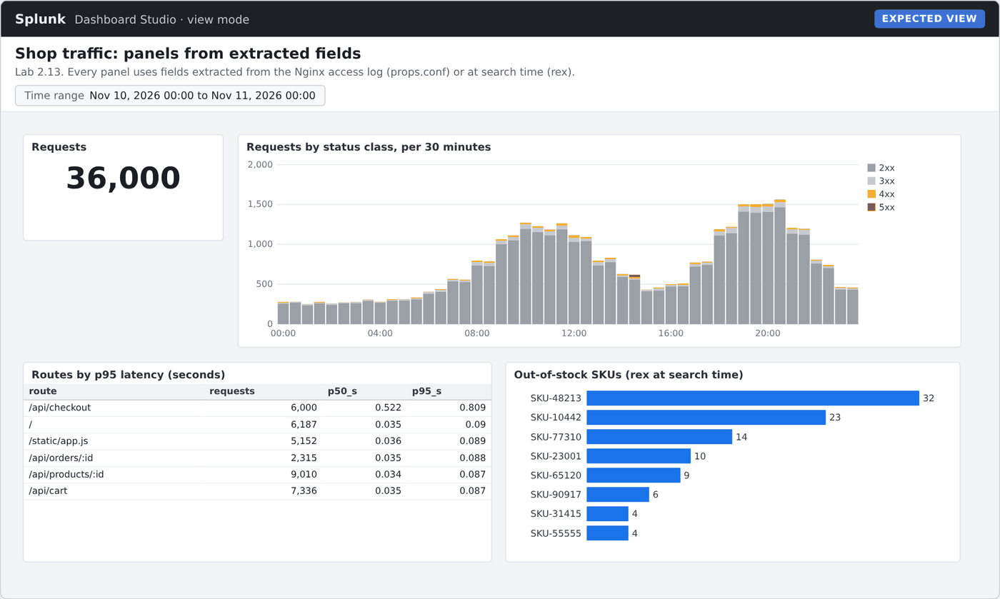
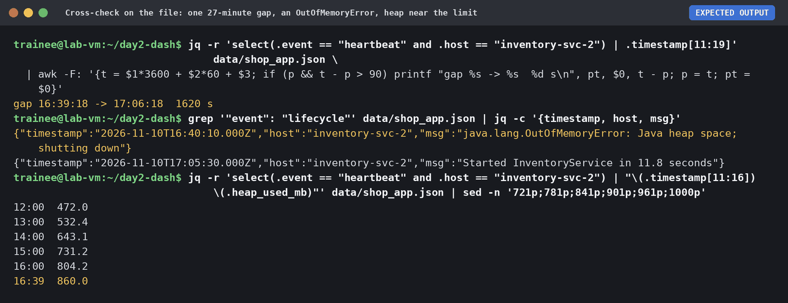

<p align="center">
  
</p>

<p align="center">
  
  
  
  
</p>

<p align="center">
  
  
  
  
  
  
  
  
  
  
  
  
</p>

<h3 align="center">🔎 Stop scrolling through logs. Start <i>reading</i> them.</h3>

<p align="center">
  A practical, lab-first course that takes you from raw log lines on a Linux shell to Splunk dashboards and alerts.<br>
  It ends with a real-feeling production incident that you investigate and write up yourself.
</p>

<p align="center">
  <a href="#why">Why</a> •
  <a href="#path">Learning path</a> •
  <a href="#day1">Day 1</a> •
  <a href="#day2">Day 2</a> •
  <a href="#workshop">Workshop</a> •
  <a href="#peek">Sneak peek</a> •
  <a href="#setup">Lab setup</a> •
  <a href="#quickstart">Quick start</a> •
  <a href="#author">Author</a>
</p>

<p align="center">
  
</p>

---

<a id="why"></a>
## ✨ Why this course

<table>
  <tr>
    <td width="33%" valign="top">
      <h4>🧪 Lab-first, not slide-first</h4>
      Every topic ends at a keyboard. Each of the 32 labs has numbered steps, expected results, questions and answers.
    </td>
    <td width="33%" valign="top">
      <h4>🎯 Real incidents, built in</h4>
      The logs tell stories: payment timeouts, deadlocks, a silent pod, a bad release, and a JVM out of memory.
    </td>
    <td width="33%" valign="top">
      <h4>🔁 Same numbers, every time</h4>
      Deterministic data generators mean your counts, times and IDs match the guides exactly.
    </td>
  </tr>
  <tr>
    <td width="33%" valign="top">
      <h4>🛠️ Shell to platform</h4>
      <code>grep</code>, <code>awk</code>, <code>jq</code> and PowerShell first, then Splunk, Elastic and Datadog, so you understand what the platform does for you.
    </td>
    <td width="33%" valign="top">
      <h4>🧩 Correlation built in</h4>
      Correlation IDs and trace IDs run through every dataset, so one request can be followed across all its logs.
    </td>
    <td width="33%" valign="top">
      <h4>📝 Evidence over opinion</h4>
      The workshop ends with an incident report in which every claim points to a log line or a search.
    </td>
  </tr>
</table>

### 👥 Who it's for

| 🚑 Production support & NOC | ⚙️ SRE & DevOps | 💻 Developers |
| :---: | :---: | :---: |
| Triage incidents faster, from logs | Turn logs into metrics, dashboards and alerts | Read stack traces and trace requests across services |

**Prerequisites:** basic Linux command line, a general idea of how web apps, APIs and databases interact, and the ability to read code in Java, .NET or Python. No prior Splunk, ELK or regex experience needed.

### 🏆 What you'll be able to do

- ✅ Identify the parts of a log entry and recognise plain text, JSON, GELF, W3C, syslog and container formats
- ✅ Separate the **first failure** from the noise it causes, and find the root cause in **Java** and **.NET** exceptions
- ✅ Filter, extract and live-monitor logs with `grep`, `awk`, `sed`, `jq`, `tail -F`, `Select-String` and `Get-WinEvent`
- ✅ Follow one transaction across services, middleware and databases with **correlation IDs** and **trace IDs**
- ✅ Search and correlate in **Splunk (SPL)**, **Elastic (KQL, Lucene, ES|QL)** and **Datadog**
- ✅ Write **regex** and **Grok** extraction rules that are correct, fast and safe
- ✅ Build an **error-signature library**, map errors to **runbooks**, and catch new signatures after a release
- ✅ Turn logs into **metrics, dashboards and alerts**, and monitor service health against **SLOs**
- ✅ Investigate an incident from start to finish and write an **evidence-backed incident report**

---

<a id="path"></a>
## 🗺️ The learning path

<p align="center">
  
</p>

| | Part | Topic | Labs | 📦 Lab pack |
| :---: | :---: | --- | :---: | --- |
| 🟢 | **Day 1 · 1** | Log fundamentals and log formats | 1.1 – 1.4 | `day1-logs.zip` |
| 🟢 | **Day 1 · 2** | Log levels and error identification | 1.5 – 1.8 | `day1-logs.zip` |
| 🟢 | **Day 1 · 3** | Linux and Windows log analysis tools | 1.9 – 1.13 | `day1-logs.zip` |
| 🟢 | **Day 1 · 4** | Correlation IDs and distributed log tracing | 1.14 – 1.16 | `day1-logs.zip` |
| 🟠 | **Day 2 · 1** | Enterprise log search platforms | 2.1 – 2.4 | `day2-logs.zip` |
| 🟠 | **Day 2 · 2** | Regex and field extraction | 2.5 – 2.8 | `day2-regex.zip` |
| 🟠 | **Day 2 · 3** | Error signature analysis and runbooks | 2.9 – 2.12 | `day2-sig.zip` |
| 🟠 | **Day 2 · 4** | Dashboards and observability | 2.13 – 2.16 | `day2-dash.zip` |
| 🔴 | **Workshop** | Integrated log investigation: INC-4471 | 6 phases | `day2-workshop.zip` |

Each part comes with a **📘 study guide** (concepts, diagrams, worked examples) and a **🧪 lab guide** (steps, expected results, questions and answers).

---

<a id="day1"></a>
<p align="center">
  
</p>

### 🧱 Part 1: Log fundamentals and log formats

Log anatomy, timestamps and time zones, structured and unstructured logs, and the common formats. Also covers where Linux and Windows keep their logs, and how rotation and retention work.

<details>
<summary><b>🧪 Labs 1.1 – 1.4</b> (2 h 30 min)</summary>

| Lab | Title | ⏱️ |
| --- | --- | --- |
| 1.1 | Identify components from sample log entries | 35 min |
| 1.2 | Convert plain text logs into structured JSON | 40 min |
| 1.3 | Identify log formats: plain, JSON, GELF, W3C | 30 min |
| 1.4 | Navigate Linux and Windows log locations and inspect logs | 45 min |

</details>

### 🚨 Part 2: Log levels and error identification

Severity levels and thresholds, mislabelled and noisy messages, and root cause versus symptom in cascading failures. Covers Java stack traces (`Caused by`, `... n more`, `Suppressed`) and .NET inner exceptions.

<details>
<summary><b>🧪 Labs 1.5 – 1.8</b> (2 h 15 min)</summary>

| Lab | Title | ⏱️ |
| --- | --- | --- |
| 1.5 | Classify log messages by severity | 30 min |
| 1.6 | Identify the first failure from cascading logs | 40 min |
| 1.7 | Analyze Java stack traces and determine root cause | 35 min |
| 1.8 | Review .NET exception logs and identify inner exceptions | 30 min |

</details>

### 🖥️ Part 3: Linux and Windows log analysis tools

Live monitoring with `tail -f` and `tail -F`, filtering and counting with `grep` and `awk`, and field extraction with `sed` and `jq`. On Windows: PowerShell for text logs, and Event Viewer and `Get-WinEvent` for failures.

<details>
<summary><b>🧪 Labs 1.9 – 1.13</b> (2 h 35 min)</summary>

| Lab | Title | ⏱️ |
| --- | --- | --- |
| 1.9 | Monitor live logs using `tail -f` | 25 min |
| 1.10 | Filter logs using `grep` and `awk` | 35 min |
| 1.11 | Extract fields from logs | 30 min |
| 1.12 | Monitor Windows logs using `Get-Content -Wait` and `Select-String` | 30 min |
| 1.13 | Locate application failures using PowerShell | 35 min |

</details>

### 🔗 Part 4: Correlation IDs and distributed log tracing

Request, correlation and trace IDs, and how they propagate between services. Covers MDC and lost context, Kafka hand-offs, span trees and waterfalls, and joining slow-query logs to a trace.

<details>
<summary><b>🧪 Labs 1.14 – 1.16</b> (1 h 50 min)</summary>

| Lab | Title | ⏱️ |
| --- | --- | --- |
| 1.14 | Trace a transaction across multiple services using correlation IDs | 35 min |
| 1.15 | Follow request flow through application, middleware and database logs | 40 min |
| 1.16 | Identify a failed transaction using its trace ID | 35 min |

</details>

---

<a id="day2"></a>
<p align="center">
  
</p>

### 🔍 Part 1: Enterprise log search platforms

Splunk architecture and SPL, the Elastic Stack and OpenSearch (KQL, Lucene and ES|QL), and the Datadog Log Explorer. Covers aggregations and correlating the web, application and database tiers.

<details>
<summary><b>🧪 Labs 2.1 – 2.4</b> (2 h 30 min)</summary>

| Lab | Title | ⏱️ |
| --- | --- | --- |
| 2.1 | Investigate an application timeout across multiple indexes in Splunk | 50 min |
| 2.2 | Build KQL queries in ELK | 40 min |
| 2.3 | Search logs using Datadog | 30 min |
| 2.4 | Correlate web, application and database logs | 30 min |

</details>

### 🧬 Part 2: Regex and field extraction

Regex building blocks and lookaround, and patterns for IPs, timestamps, status codes and correlation IDs. Covers regex engines and catastrophic backtracking, safe regex with RE2, and Grok and dissect rules.

<details>
<summary><b>🧪 Labs 2.5 – 2.8</b> (2 h 25 min)</summary>

| Lab | Title | ⏱️ |
| --- | --- | --- |
| 2.5 | Write regex patterns to extract IP addresses, timestamps, HTTP status codes and correlation IDs | 40 min |
| 2.6 | Validate regex performance | 30 min |
| 2.7 | Create field extraction rules using Grok patterns | 45 min |
| 2.8 | Test safe regex patterns | 30 min |

</details>

### 🏷️ Part 3: Error signature analysis and runbooks

Error signatures and message normalization, signature libraries and clustering with Drain. Covers known errors and runbook mapping, and catching new or spiking signatures after a release. Ends with log-to-metric rules in **Vector** and **Prometheus**.

<details>
<summary><b>🧪 Labs 2.9 – 2.12</b> (2 h 30 min)</summary>

| Lab | Title | ⏱️ |
| --- | --- | --- |
| 2.9 | Build an error signature library from application logs | 40 min |
| 2.10 | Map recurring errors to runbooks | 30 min |
| 2.11 | Identify unknown error signatures | 35 min |
| 2.12 | Create a log-to-metric rule for HTTP 5xx errors | 45 min |

</details>

### 📊 Part 4: Dashboards and observability

Splunk Dashboard Studio, field-based visualizations, and log-based metrics (`mcollect`, `mstats`). Covers trend analysis and forecasting, alerting on log patterns, and operational dashboards with drilldowns. Ends with service health from heartbeats and SLO error budgets.

<details>
<summary><b>🧪 Labs 2.13 – 2.16</b> (3 h 05 min)</summary>

| Lab | Title | ⏱️ |
| --- | --- | --- |
| 2.13 | Create dashboard panels using extracted fields | 45 min |
| 2.14 | Build error-rate and transaction dashboards | 50 min |
| 2.15 | Configure alerts based on log patterns | 50 min |
| 2.16 | Monitor application health using dashboards in Splunk | 40 min |

</details>

> [!TIP]
> Lab 2.15 includes `bin/replay.py`. It replays the incident window at the current time and faster than real time, so you can watch your scheduled alerts actually **fire** 🔔.

---

<a id="workshop"></a>
<p align="center">
  
</p>

> 🚨 **INC-4471 · SEV-2.** The 5xx error rate on `shop.example.com` hit **11.8%**. On-call restored the service, but nobody knows *why*.
> **You are the investigator.**

You bring everything together: Linux logs, Java stack traces and GC logs, Splunk searches, regex extraction, correlation IDs and a dashboard. Then you write a structured incident report with evidence behind every claim.

| | Phase | The question | ⏱️ |
| :---: | --- | --- | :---: |
| ⚙️ | Setup | Load the logs into Splunk | 15 min |
| 📏 | **1. Scope the impact** | Who was affected, how badly, and when? | 25 min |
| 🖥️ | **2. Host and service state** | What happened to the service and the host? | 20 min |
| ☕ | **3. Java evidence** | Why did the JVM fail? | 30 min |
| 🎯 | **4. Find the trigger** | What started it, and why now? | 25 min |
| 📊 | **5. Incident dashboard** | Show the incident on one screen | 25 min |
| 📝 | **6. Root cause and report** | Write it up | 40 min |

The pack includes an incident report template, an evidence log template and a model dashboard.

> [!NOTE]
> A **model incident report** is available to facilitators. Participants should compare their report with it only after finishing.

---

<a id="peek"></a>
## 👀 Sneak peek

<table>
  <tr>
    <td width="50%" align="center">
      <br>
      <sub><b>Lab 2.14</b> · Operations dashboard with drilldown from a slow checkout to its trace</sub>
    </td>
    <td width="50%" align="center">
      <br>
      <sub><b>Lab 2.16</b> · Service health from heartbeats, with SLO error budget</sub>
    </td>
  </tr>
  <tr>
    <td width="50%" align="center">
      <br>
      <sub><b>Lab 2.13</b> · Panels built from extracted fields</sub>
    </td>
    <td width="50%" align="center">
      <br>
      <sub><b>Lab 2.16</b> · Cross-checking a silent pod on the raw file with <code>jq</code> and <code>awk</code></sub>
    </td>
  </tr>
</table>

<sub>Splunk screens are <b>Expected views</b> drawn from the lab data. Every number is computed with the same logic as the search, but your screen will look different. Terminal pictures are real output.</sub>

---

<a id="setup"></a>
## 🧰 Lab environment

| | Requirement | Used in |
| :---: | --- | --- |
| 🐧 | Ubuntu 22.04 or 24.04 VM with `sudo` (WSL2 works for Labs 1.1–1.3) | All Linux labs |
| 🐍 | `jq`, Python 3.9+, `tzdata`, `file`, `logrotate` | Day 1 and Day 2 |
| 🧬 | Python 3.11+, GNU `grep -P`, `regex` and `google-re2` in a virtual environment | Day 2 · Part 2 |
| 🪟 | Windows 10/11 or Server 2019+, PowerShell as administrator | Labs 1.4 (Part B), 1.12, 1.13 |
| 🐳 | Docker with 4 CPU cores and 8 GB RAM free (run one platform at a time if you have less) | Day 2 · Parts 1 and 4, Workshop |
| 🔎 | Splunk Enterprise (`splunk/splunk`), Elasticsearch and Kibana 8.15.3 images | Labs 2.1–2.4, 2.13–2.16, Workshop |
| 🐶 | A Datadog free-trial account | Lab 2.3 |
| 📈 | Vector 0.43.1 and Prometheus 2.55.1 (single binaries) | Lab 2.12 |

> [!TIP]
> No Windows machine? Lab 1.12 also runs in PowerShell 7 on the Ubuntu VM: `sudo snap install powershell --classic`.

### 📁 Repository layout

```text
.
├── README.md
├── assets/                 # Graphics used by this README
├── docs/
│   ├── day1/                # Day 1 study and lab guides, Parts 1–4 (PDF)
│   └── day2/                # Day 2 study and lab guides, Parts 1–4, and the workshop guide (PDF)
└── labs/
    ├── day1-logs.zip        # Day 1 sample logs and generators (make_day1_*.py)
    ├── day2-logs.zip        # Splunk, ELK and Datadog (make_day2_part1.py)
    ├── day2-regex.zip       # Regex, Grok and safe regex (make_day2_part2.py)
    ├── day2-sig.zip         # Signatures, runbooks, Vector and Prometheus (make_day2_part3.py)
    ├── day2-dash.zip        # Dashboards, alerts and the replay tool (make_day2_part4.py)
    └── day2-workshop.zip    # INC-4471 incident workshop (make_workshop.py)
```

---

<a id="quickstart"></a>
## 🚀 Quick start

Each pack unzips into its own folder in your home directory. Run the labs from that folder.

```bash
# 🟢 Day 1 (all four parts share one folder)
sudo apt update && sudo apt install -y jq python3 tzdata file logrotate
unzip -o day1-logs.zip -d ~ && cd ~/day1-logs && mkdir -p bin out

# 🟠 Day 2 · Part 1: Splunk, ELK, Datadog
unzip -o day2-logs.zip -d ~ && cd ~/day2-logs

# 🟠 Day 2 · Part 2: regex
unzip -o day2-regex.zip -d ~
python3 -m venv ~/.venvs/regex && . ~/.venvs/regex/bin/activate
pip install regex google-re2
cd ~/day2-regex

# 🟠 Day 2 · Part 3: error signatures
unzip -o day2-sig.zip -d ~ && cd ~/day2-sig

# 🟠 Day 2 · Part 4: dashboards and alerts
unzip -o day2-dash.zip -d ~ && cd ~/day2-dash

# 🔴 Workshop
unzip -o day2-workshop.zip -d ~ && cd ~/inc4471
```

💡 Every pack ships a `make_*.py` generator. Regenerate the logs instead of unzipping and you get **byte-identical** output.

🐳 The Splunk labs start Splunk in Docker. The lab folder is mounted read-only and the lab's Splunk app is mounted into `etc/apps`. The exact `docker run` command is in each lab guide's setup step.

---

## 🛡️ About the sample data

- 🎭 **Everything is invented.** Hosts, users, customers, orders and IDs are fictional. IPs come from the documentation ranges (`192.0.2.0/24`, `198.51.100.0/24`, `203.0.113.0/24`, `2001:db8::/32`). Domains use `example.com` or `.internal`.
- 🔁 **Deterministic.** Fixed random seeds, so counts, times and IDs match the guides exactly.
- 💥 **Incidents included:** a payment-provider timeout, database deadlocks, a pod that stops sending heartbeats, a bad release with new error signatures, and a JVM out of memory during a B2B invoice export.
- ⛔ **Never replace the sample logs with real production logs** when you share or reuse this material.

> [!WARNING]
> **Secrets.** The Splunk admin password in the guides (`Lab-Passw0rd!`) is for local lab containers only. The Datadog lab reads your key from the `DD_API_KEY` environment variable. **Never commit API keys, tokens or passwords** to this repository.

### 📖 How to read the guides

- 🟦 **Expected output:** real output from the lab files. Yours should match.
- 🟪 **Expected view:** platform screens (Splunk, Kibana, Datadog) drawn from the same data, with every number computed by the same logic as the query.
- 🕒 **All times are UTC.** Set your platform to UTC, or every time shifts by your offset.
- ❓ Every lab ends with questions. The answers, a troubleshooting table and clean-up steps are in each lab guide's appendix.

---

<a id="author"></a>
## 👨‍🏫 Author

<table>
  <tr>
    <td valign="middle">
      <h3>Vivek Arora</h3>
      <b>Corporate Trainer, Author &amp; Consultant</b> · StackMaster Tech, Bengaluru<br>
      Cloud · Data Engineering · Observability · SRE · DevSecOps · Generative AI<br><br>
      <a href="https://www.linkedin.com/in/vivek11arora"></a>
      <a href="https://www.youtube.com/@StackMasterTech"></a>
      <a href="https://github.com/vivek9325"></a>
      <a href="mailto:vivek9325@gmail.com"></a>
    </td>
  </tr>
</table>

🎓 **Want this course for your team?** Get in touch for corporate delivery, onsite or virtual.

<p align="center">
  <b>⭐ If this material helped you, star the repo. It helps others find it.</b>
</p>

---

<sub>© 2026 StackMaster Tech. All rights reserved. The Logstash pattern files in <code>day2-regex.zip</code> (<code>patterns/</code> from <code>logstash-patterns-core</code>) are under the Apache-2.0 licence. Splunk, Elastic, Kibana, Datadog, Vector and Prometheus are trademarks of their respective owners. This course is independent and not endorsed by them.</sub>
